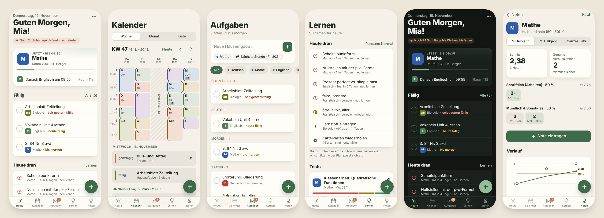
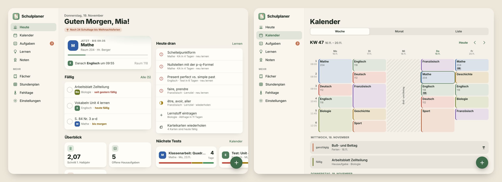

# Schulplaner

Stundenplan, Hausaufgaben, Tests, Lernplan, Karteikarten und Noten an einem Ort – als App für iPhone und iPad.
Funktioniert offline, synchronisiert sich auf Wunsch zwischen iPhone und iPad und kommt in einem ruhigen
**Salbei & Creme**-Look (hell und dunkel, weitere Farbwelten wählbar).





## Funktionen

| | |
|---|---|
| **Heute** | Laufende und nächste Stunde mit Raum, Ferien-Countdown („Noch 24 Schultage bis Weihnachtsferien“), fällige Hausaufgaben zum Abhaken, „Heute dran“, nächste Tests mit Countdown, Hinweise (Test heute, Note noch eintragen, Entschuldigung offen) und der aktuelle Schnitt. |
| **Stundenplan** | Zum Antippen oder Malen: Fach wählen, auf die Stunden tippen. Stundenzeiten, Mo–Fr oder Mo–Sa, **A/B-Wochen**. |
| **Kalender** | Woche als Stundenplan mit Tests, fälligen Hausaufgaben und Ferien; Monat mit Tagesliste; Liste der nächsten 8 Wochen. Termine wie Wandertag, Elternabend oder unterrichtsfreie Tage. |
| **Hausaufgaben** | Schnelleingabe schlägt das Fach der laufenden Stunde vor. „**Nächste Stunde**“ setzt das Datum automatisch – Wochenenden, Ferien und freie Tage werden übersprungen. |
| **Lernen** | Zu jedem Test die Themen eintragen und mit der **Ampel** einschätzen. Daraus entsteht jeden Tag „**Heute dran**“: rote Themen zuerst, gleichmäßig bis zum Testtag verteilt, am Vortag die Generalprobe. Lernziele auch ohne Termin. |
| **Karteikarten** | Stapel je Fach, Import aus Listen („house – Haus“), Abfrage mit dem **5-Fächer-System** (Wiederholung nach 1, 2, 4, 8 und 16 Tagen). |
| **Noten** | Noten 1–6 mit **+ und −** (Wert einstellbar: 0,25 / 0,3 / 0,33), schriftlich/mündlich je Fach gewichtet, Einzelgewichte, Gesamtschnitt (Hauptfächer auf Wunsch doppelt), Halbjahre. |
| **Zeugnis-Prognose & Verlauf** | Voraussichtliche Zeugnisnote je Fach mit Hinweis, wenn sie wackelt, und ein Diagramm mit dem Notenverlauf. |
| **Zielnoten-Rechner** | „Welche Note brauche ich in der nächsten Arbeit für eine 2?“ |
| **Ferien automatisch** | Schulferien und Feiertage des Bundeslands werden geladen und offline gespeichert. |
| **iPhone-Kalender** | Tests und Termine mit einem Tipp in den iPhone-Kalender – mit Erinnerung am Vortag (oder 2 Tage / 1 Woche vorher). |
| **Fehltage** | Fehltage und -stunden je Halbjahr, Frist für die Entschuldigung, verpasste Stunden aus dem Stundenplan und „Stoff nachholen“ als Aufgaben. |
| **iPad** | Eigene Darstellung mit Seitenleiste, zwei Spalten und breitem Wochenplan – im Hoch- und Querformat. |
| **Sync & Backup** | Mit eigenem Supabase-Projekt haben iPhone und iPad dieselben Daten. Backup als Datei jederzeit möglich. |

---

## Einrichten (einmalig)

### 1. App veröffentlichen (GitHub Pages, kostenlos)

1. Den Pull Request nach `main` mergen.
2. Das Repository muss **öffentlich** sein (*Settings → General → Change repository visibility*).
   Öffentlich ist nur der Programmcode – die Daten liegen nie im Repository.
3. *Settings → Pages* → bei *Build and deployment* als **Source „GitHub Actions“** wählen.
4. Unter *Actions* den Workflow „App auf GitHub Pages veröffentlichen“ einmal starten (*Run workflow*).
   Danach läuft er nach jeder Änderung an `main` automatisch.
5. Die App ist dann erreichbar unter **https://lukas1210.github.io/schulplaner/**

### 2. Sync einrichten (Supabase, kostenlos)

Damit iPhone und iPad dieselben Daten haben. Die App funktioniert auch ohne – dann bleiben die Daten auf dem jeweiligen Gerät.

1. Auf [supabase.com](https://supabase.com) → **New project**
   - Name: `schulplaner`, Region: *Frankfurt (eu-central-1)*, Datenbank-Passwort frei wählen.
   - Im kostenlosen Tarif sind zwei aktive Projekte erlaubt.
2. **SQL Editor → New query** → den Inhalt von [`supabase/setup.sql`](supabase/setup.sql) einfügen → **Run**.
3. **Authentication → Users → Add user → Create new user**: ein Konto für die Schülerin (E-Mail + Passwort), „Auto Confirm User“ anhaken.
4. Das Skript aus Schritt 2 **noch einmal** ausführen. Dadurch wird das Konto freigeschaltet; die Abfrage am Ende zeigt die E-Mail-Adresse.
5. **Authentication → Sign In / Providers** → „Allow new users to sign up“ **ausschalten**.
6. **Project Settings → API**: **Project URL** und **publishable** (bzw. *anon public*) Key in [`app/config.js`](app/config.js) eintragen
   (auf GitHub: Datei öffnen → ✏️ → Commit). Alternativ in der App unter *Einstellungen → Synchronisation → Zugangsdaten eingeben*.

### 3. Auf iPhone und iPad installieren

1. Die Adresse aus Schritt 1 in **Safari** öffnen.
2. **Teilen** → **„Zum Home-Bildschirm“** → **Hinzufügen**.
3. Die App vom Home-Bildschirm öffnen:
   - **Erstes Gerät:** „Loslegen“ → Name, Klasse, Bundesland, Fächer, Plus/Minus-Wert → danach unter *Einstellungen → Synchronisation* anmelden.
   - **Zweites Gerät:** „Ich habe schon ein Konto“ → anmelden – alles wird geladen.

---

## Gut zu wissen

- **Wo liegen die Daten?** Auf dem Gerät (IndexedDB) und – mit Sync – im eigenen Supabase-Projekt.
  Lesen und Schreiben ist nur mit dem freigeschalteten Konto möglich. Wer das Supabase-Projekt verwaltet, kann die Daten im Dashboard technisch einsehen.
- **Ferien & Feiertage** kommen von der [OpenHolidays API](https://www.openholidaysapi.org). Gesendet wird nur das Bundesland-Kürzel.
  Die Daten werden 30 Tage zwischengespeichert. Eigene freie Tage trägst du im Kalender als Termin „Unterrichtsfrei“ ein.
- **Erinnerungen** kommen vom iPhone-Kalender: Beim Test bzw. Termin auf „In den iPhone-Kalender“ tippen.
  Eigene Push-Mitteilungen der App bräuchten einen Server.
- **Plus und Minus** zählen je nach Schule unterschiedlich – unter *Einstellungen → Noten* einstellbar.
  Die Zeugnisnote ist eine Prognose: Ein Schnitt unter x,5 ergibt x; liegt er weniger als 0,1 an der Grenze, zeigt die App „wackelt“. Am Ende entscheidet die Lehrkraft.
- **Offline:** Die App startet ohne Netz; Änderungen werden übertragen, sobald wieder Verbindung besteht.
- **Updates:** Nach einer neuen Version zeigt die App „Neue Version verfügbar“ – ein Tipp genügt.
- **Supabase Free** pausiert ein Projekt nach etwa einer Woche ohne Nutzung; im Dashboard mit „Restore“ wieder starten, es geht nichts verloren.

---

## Für Entwickler

Reines HTML, CSS und JavaScript ohne Build-Schritt. Mitgeliefert ist nur `app/vendor/supabase.min.js` (MIT).

```bash
cd app && python3 -m http.server 8000   # lokal starten → http://localhost:8000
node tools/test-logic.mjs                # Unit-Tests: Noten, Stundenplan, Lernplan, Karteikarten, Ferien, .ics
node tools/test-sync.mjs                 # Sync-Tests mit iPhone und iPad gegen ein Fake-Backend
node tools/e2e/run.cjs                   # End-to-End-Tests im iPhone- und iPad-Format (Playwright/Chromium)
node tools/e2e/run.cjs tour              # Screenshot-Rundgang → docs/screenshots.jpg, docs/ipad.jpg
node tools/palettes.mjs                  # Farbwelten prüfen (Kontraste) und css/palettes.css erzeugen
node tools/make-icons.mjs                # App-Icon und Startbilder neu erzeugen
node tools/update-sw.mjs                 # Offline-Dateiliste im Service Worker aktualisieren
```

```
app/
  index.html, manifest.webmanifest, sw.js, config.js
  css/app.css                 Design-System, iPad-Layout ab 768 px
  css/palettes.css            Farbwelten (erzeugt mit tools/palettes.mjs)
  js/main.js                  Start, Tab-Leiste, Seitenleiste, „+“-Menü, Service Worker
  js/store.js, db.js          Daten (IndexedDB, offline first)
  js/sync.js                  Supabase-Sync (Push/Pull, Realtime)
  js/holidays.js, ics.js      Ferien laden, Kalender-Export
  js/logic/*.js               reine Logik (Noten, Stundenplan, Lernplan, Karteikarten, Ferien, .ics)
  js/views/*.js, forms/*.js   Bildschirme und Formulare
supabase/setup.sql            Datenbank, Rechte, Speicher für Kalenderdateien
.github/workflows/pages.yml   Veröffentlichung auf GitHub Pages
```
